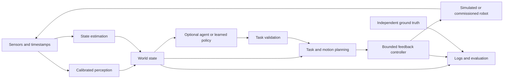

# Physical AI system interfaces

The capstones share a perception–estimation–planning–control architecture. Begin with deterministic components and replayable inputs; introduce learned task decisions only after the system can reject invalid goals and handle missing data.

Ground truth is evaluator-only. It must not enter the estimator through simulator convenience topics. A language model proposes high-level tasks; the executor checks their validity and the controller enforces motion limits.

## Contracts to define before integration

| Boundary | Required fields/semantics | Failure response |
| --- | --- | --- |
| Sensor → processing | Sequence ID, capture timestamp/clock, frame ID, units, calibration version | Drop invalid samples; count missing/stale data |
| Perception → world state | Source observation ID, object identity/class, pose/frame, uncertainty convention, validity interval | Mark unknown or stale; avoid invented certainty |
| Estimator → planner | State/frame, timestamp, covariance interpretation, localization health | Hold/reject mission when health fails |
| Task layer → executor | Request ID, goal/frame, limits, timeout, preconditions, expected result | Reject invalid/stale/duplicate tasks; return reason |
| Planner → controller | Feasible trajectory, timestep, limits, frame, command expiry | Bounded stop/hold on expiry or infeasible plan |
| System → evaluator | Config/model versions, event IDs, input/output timestamps, fault transitions | Preserve failures and dropped-event counts |

Use `T_A_B` for a transform mapping B coordinates into A; column-vector composition is `T_A_C = T_A_B T_B_C`. Keep middleware frame conventions distinct from autopilot NED/body conventions and test each conversion on basis vectors.

## Timing and authority

Use monotonic clocks for local elapsed-time measurements and label sensor/simulation/wall clocks explicitly. Never subtract timestamps from different clocks without a synchronization model. Record capture-to-command age separately from model execution time.

The actuator path enforces rate, joint/velocity/workspace limits, expiry, and stop behavior independently of the task planner. A physical emergency stop and motor-power isolation remain hardware mechanisms; a software watchdog is only one part of commissioning.

## Integration sequence

First validate each boundary with synthetic fixtures, then replay recorded inputs, then close the loop in simulation. Freeze scenarios and inject sensor/command failures. Physical work follows the [hardware progression](../hardware/README.md). Record changes to interfaces as explicit design decisions rather than silently adapting consumers.
